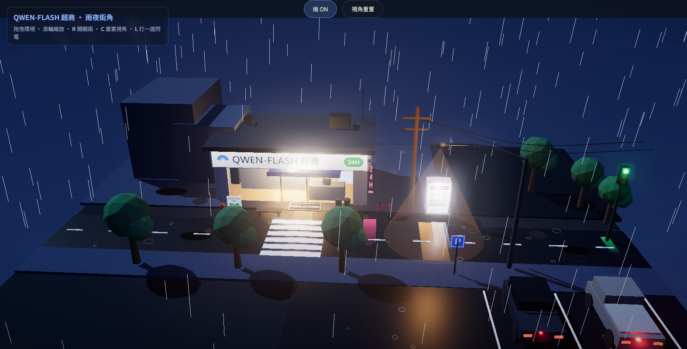

# QWEN-FLASH 超商 · 雨夜街角（3D webside）

three.js 單檔 3D 場景：雨夜中的浮島便利店 diorama。

## 內容
- QWEN-FLASH 超商（發光招牌、玻璃門內貨架/冷藏櫃/收銀台、WELCOME 地墊、24H 粉紅霓虹）
- 斑馬線、車道虛線、停車場與兩輛車（尾燈發光）、販賣機、電信桿與電線、彎臂路燈（體積光錐）、綠燈號誌、P 牌、舊建築、消防栓、看板、長椅、腳踏車、6 棵微風搖曳的樹
- 雨：900 條雨絲 + 地面水花漣漪；濕柏油燈光倒影、積水鏡面
- 後製：UnrealBloom 輝光、ACES 色調映射；每 14–30 秒自動閃電

## 開啟方式
直接雙擊 `index.html`（使用 CDN importmap，需網路連線）。

## 操作
| 動作 | 方式 |
|---|---|
| 環視 / 縮放 | 拖曳 / 滾輪 |
| 開關雨 | 按鈕或 `R` |
| 重置視角 | 按鈕或 `C` |
| 手動閃電 | `L` |
